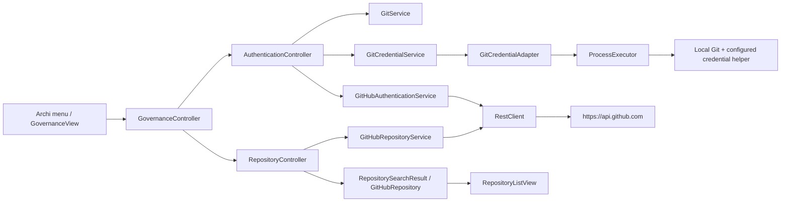

# Governance for Archi

Governance is an Archi 5.11.0 plug-in for authenticating as the signed-in local Git user and searching repositories that GitHub makes accessible to that user. It performs read-only Git configuration/process queries and HTTPS `GET` requests; it never clones, writes, or changes GitHub permissions.

## Compatibility

- Target Archi: **5.11.0**.
- Java: **21** (`JavaSE-21`, as declared by Archi 5.11.0).
- Git: the user's local Git installation must be on `PATH`.
- Git Credential Manager (or another configured Git credential helper) must be available through the user's Git configuration. A returned Git password is not assumed to be an API token: Governance validates it with `GET https://api.github.com/user`.
- Build container: Eclipse Temurin **21.0.9+10**, pinned by image digest. The official Archi 5.11.0 Linux bundle archive is checksum-verified and supplies the compile-time Eclipse RCP/SWT/JFace/OSGi bundles.

The Docker container is a **build-only** environment. At runtime Archi launches the plug-in on the user's operating system, where it invokes that operating system's Git/Git Credential Manager. The container does not provide or receive user credentials.

## Architecture



The SWT/JFace views only render state and forward user actions. Controllers coordinate work on a background executor; process and HTTP services do not depend on SWT. Git identity (`user.name` / `user.email`) and GitHub identity (`GET /user`) are displayed separately. Organization and topic preferences are stored through Eclipse instance preferences; credentials are not.

## Authentication and security

Governance calls the standard Git credential protocol with `git credential fill`, sending `protocol=https` and `host=github.com` through process stdin. The configured credential helper remains responsible for any required sign-in. Credential process output is captured, parsed, and cleared from byte/character buffers; the candidate password is never put in arguments, a URL, preferences, logs, or UI. The candidate is used only as `Authorization: Bearer …` on the fixed HTTPS GitHub API origin and is validated using `GET /user`.

If Git returns a credential that GitHub REST rejects (for example, a Git-only password or expired credential), Governance reports the incompatibility and does not try another authentication mechanism. Redirects are disabled and `RestClient` rejects non-HTTPS or non-`api.github.com` request URIs before attaching authorization. GitHub determines which repositories the authenticated user can see.

The standalone Windows diagnostic used to validate this flow is `scripts/poc-github-auth.ps1`. It is not invoked by the plug-in and is not part of the runtime bundle.

## Build and tests

Requirements on the build host: Docker Engine and Docker Compose. No local Java, Maven, Eclipse PDE, or GitHub token is required to build.

From PowerShell at the repository root:

```powershell
docker compose build
docker compose run --rm builder
```

The same container scripts compile, run mock-based tests, create and validate the bundle and write artifacts to `dist/`. The unit tests do not use real credentials or GitHub responses.

Direct Docker use:

```powershell
docker build -f docker/Dockerfile -t archi-governance-builder .
docker run --rm -v "${PWD}:/workspace" archi-governance-builder
```

On Linux, supply the checkout owner UID/GID to `docker run` if needed:

```sh
docker run --rm --user "$(id -u):$(id -g)" -v "$PWD:/workspace" archi-governance-builder
```

Scripts, available inside the build image:

```sh
sh scripts/test.sh
sh scripts/build.sh
sh scripts/package.sh
```

`test.sh` compiles the current Java sources and runs automated tests. `package.sh` also creates and validates the JAR and `.archiplugin`, checks the OSGi manifest and extension XML, validates ZIP integrity, and verifies `SHA256SUMS`.

## Install in Archi on Windows

1. Install **Archi 5.11.0** from the [official archive](https://www.archimatetool.com/archive/).
2. Build the plug-in and locate `dist/governance-0.1.0.archiplugin`.
3. In Archi choose **Help → Manage Plug-ins… → Install New…** and select the `.archiplugin`.
4. Approve the requested restart.
5. Open **Governance → GitHub Repositories…**.

## Configure and validate

1. Confirm Governance reports local Git and (if configured) the Git credential helper. The displayed `user.name` and `user.email` are local Git configuration, not proof of GitHub identity.
2. Enter organization `repository-governance` and leave Repository Topic as `archimate` (the default).
3. Select **Connect**. If Git Credential Manager prompts, complete its normal sign-in interaction. Governance then validates the resulting credential against GitHub `/user`.
4. Confirm the GitHub account shown is the expected authenticated user and inspect the complete repository result list. The search succeeds with an empty result if no accessible repository matches; authentication, authorization, rate-limit, and incomplete-search failures are reported separately.
5. For the known acceptance check, `SBB-009999` should appear if it remains accessible to the signed-in user and still has the `archimate` topic. Select a row and choose **Open selected repository** to open its GitHub page in the default browser.
6. Use **Refresh** to repeat the search with the current in-memory session. Closing the window cancels work and clears the in-memory session token.

To reproduce the earlier real authentication diagnostic outside Archi, run:

```powershell
powershell.exe -NoProfile -ExecutionPolicy Bypass -File .\scripts\poc-github-auth.ps1
```

The script prints only the `/user` HTTP status, authenticated login, and repository names. It uses no mocks and never prints the credential. The successful PoC was observed in this environment; it does not replace the manual plug-in UI validation above.

## Errors and limitations

- **Git not found:** install Git and add it to the environment used to launch Archi.
- **No helper configured:** configure a Git credential helper locally (Git Credential Manager is recommended); Governance does not ask for or store a PAT itself.
- **Git credential rejected by `/user`:** the credential may not be a REST bearer token, or may be expired/revoked. No fallback is attempted.
- **401/403/404/422/429:** Governance reports authentication, access, query, or rate-limit guidance. It does not try to bypass GitHub's access controls.
- **Incomplete search or over 1,000 results:** no partial repository list is shown; narrow the topic and retry.
- **Network/DNS/TLS failure:** check connectivity, proxy configuration, and the system certificate store. Certificate validation remains enabled.

Automated tests and artifact checks run in Docker. A successful Docker build does **not** prove installation in Archi; a native Archi 5.11.0 Windows launch remains a manual validation step.

## Artifacts

Generated in `dist/`:

- `governance-0.1.0.jar` — OSGi bundle.
- `governance-0.1.0.archiplugin` — official Archi plug-in ZIP containing the marker and bundle JAR.
- `SHA256SUMS` — hashes of both deliverables.

The plug-in version is defined once in `VERSION`.
